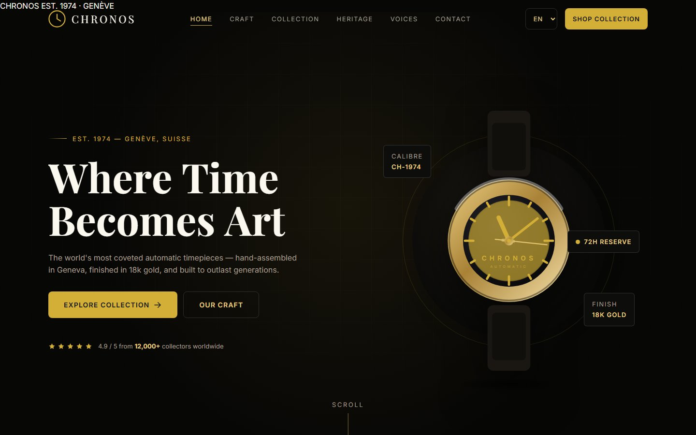

<div align="center">

# ⌚ Chronos Watches

**A luxury watch landing page that treats performance as a design constraint.**

[](https://github.com/Salar11111/Chronos-Watches/actions/workflows/ci.yml)


</div>

---

## ✨ Why Chronos?

A watch site lives or dies on imagery, but that is no excuse for shipping a slow page. Chronos keeps the first paint small and earns the rest back with code-splitting, lazy-loaded below-fold sections, self-hosted fonts and a canvas particle system that only runs when it should. Bundle budgets are enforced in CI, so "fast" stays fast.

It is also built to travel: English, French and German copy through a small custom i18n layer, consent-gated analytics, Sentry for errors, and a service worker for offline caching. Tests cover both the modules and the rendered page.

### 🧩 What's inside

- ⚡ **Vite 6 + TypeScript** — a small, modular front end.
- 📦 **Bundle budgets** — 60 KB JS / 40 KB CSS (gzip), checked by `npm run size`.
- 🌍 **Multi-language** — EN/FR/DE with custom i18n.
- 🎛️ **Consent-gated analytics** — GA4 only after consent; Sentry for error tracking.
- ❄️ **Canvas particles** with `requestAnimationFrame`.
- 👀 **Intersection Observer** lazy-loading for below-fold sections.
- 📴 **Service worker** for offline caching.
- 🧪 **Vitest + Playwright** — unit and E2E coverage.

---

## 📸 Screenshots



---

## 🚀 Quick start

```bash
npm install
npm run dev
```

---

## 🧱 Stack

| Layer | Choice |
| --- | --- |
| Build | Vite 6 |
| Language | TypeScript |
| Styling | Modular CSS with tokens |
| Tests | Vitest, Playwright |
| Quality | ESLint, Stylelint, Prettier, bundle-size checker |
| Extras | Sentry, GA4, service worker, custom i18n |

---

## 🗂 Project structure

```text
chronos-landing/
├── src/
│   ├── components/    # Reusable components (ProductCard)
│   ├── data/          # Product catalog data
│   ├── modules/       # Preloader, navigation, particles, i18n, …
│   ├── styles/        # Tokens, components, sections
│   ├── __tests__/     # Unit tests
│   └── main.ts        # Entry point with critical init
├── e2e/               # Playwright specs
├── scripts/           # Bundle size checker
├── public/            # Fonts, sw.js, sitemap
├── vite.config.ts
└── .github/           # CI workflow
```

---

## 🔧 Scripts

| Command | Description |
| --- | --- |
| `npm run dev` | Start dev server |
| `npm run build` | Build for production |
| `npm run preview` | Preview production build |
| `npm run lint` | ESLint |
| `npm run stylelint` | Stylelint |
| `npm run format` | Prettier |
| `npm run test:run` | Unit tests |
| `npm run test:e2e` | E2E tests |
| `npm run size` | Check bundle size budget |
| `npm run coverage` | Unit tests with coverage |

---

## 🔐 Environment variables

Copy `.env.example` to `.env` and fill in:

| Variable | Description |
| --- | --- |
| `VITE_SENTRY_DSN` | Sentry DSN for error tracking |

---

## ✅ Tests & quality

```bash
npm run lint
npm run stylelint
npm run test:run
npm run test:e2e
npm run size
```

CI runs the same gates, including the bundle-size budget, on every push.

---

## 🗺 Roadmap ideas

- 🖼️ Product detail pages with a gallery
- 🛒 A cart mock-up wired to local state
- 📊 Real-user monitoring for Core Web Vitals
- 🌐 More locales with the same i18n layer

---

<div align="center">

Fast by design, precise by habit. Built with Vite and TypeScript.

</div>
